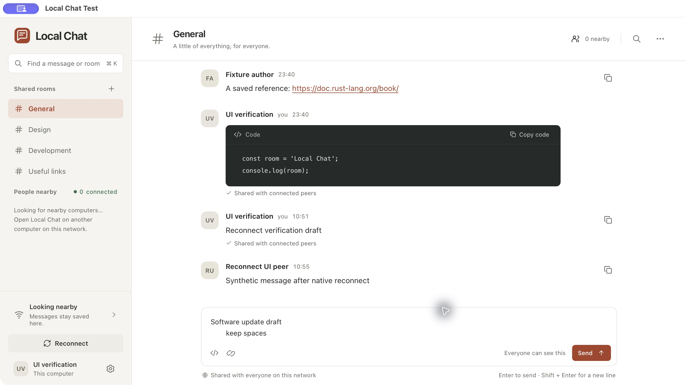

<p align="center">
  
</p>

<h1 align="center">Local Chat</h1>

<p align="center">Conversations, links, and code. Shared on your local network.</p>

<p align="center">
  <a href="https://github.com/youssefsz/local-chat/actions/workflows/ci.yml"></a>
  <a href="https://github.com/youssefsz/local-chat/releases/latest"></a>
  <a href="LICENSE"></a>
  <a href="docs/platform-status.md"></a>
</p>

<p align="center">
  <a href="https://local-chat.youssef.tn">Website</a> ·
  <a href="https://local-chat.youssef.tn/download">Download</a> ·
  <a href="#get-started">Get started</a> ·
  <a href="CONTRIBUTING.md">Contribute</a> ·
  <a href="SUPPORT.md">Get help</a> ·
  <a href="SECURITY.md">Security</a>
</p>

<picture>
  <source media="(prefers-color-scheme: dark)" srcset="docs/screenshots/dark-1280x720.jpg">
  
</picture>

*The native app with synthetic conversations. Screenshots contain no private chat history.*

Local Chat connects nearby computers without an account or a separate server. Share text, links, and exact code snippets in public rooms on the current LAN. History, drafts, and search stay on each computer. Chat works without internet; optional update checks use GitHub.

## What you can do

- Find nearby computers automatically on the same Wi-Fi or Ethernet network.
- Use General or create named shared rooms. Room creators control renaming and archiving.
- Send text, links, and code with exact copying and persistent drafts.
- Search local history and catch up when peers reconnect.
- Choose Light, Dark, or System appearance.
- Reconnect from the sidebar and check for signed app updates in Settings.

## Download

Download the first public release, `0.0.1`, from the [website](https://local-chat.youssef.tn/download). Download buttons follow the latest published stable release. The [release page](https://github.com/youssefsz/local-chat/releases/latest) lists changes, checksums, and contributor credits. This is early software; keep separate copies of important information.

| Platform | Architecture | Download and status |
| --- | --- | --- |
| macOS | Apple Silicon ARM64 | DMG. Developer ID signed and notarized. |
| Windows | x64 | Installer. Intentionally unsigned; SmartScreen may warn. |
| Linux | x64 | AppImage or Debian package. |

CI builds and tests these targets. Physical Windows and Linux desktop, firewall, LAN, and update-installation checks remain pending. See [platform status](docs/platform-status.md).

Earlier test builds used `0.1.0-beta` versions, which sort above `0.0.1`. Beta users need one manual installation of `0.0.1`, then must select the Stable update channel in Settings. Updater downgrade protection stays enabled. Later updates can be downloaded and installed from the app. Debian installations use downloaded packages.

## Get started

1. Install and open Local Chat on computers connected to the same LAN.
2. Allow Local Network access or incoming connections when your operating system asks.
3. Open General and start a conversation. Peers appear automatically when discovery is permitted.

Choose **Reconnect** below the sidebar connection status if discovery or messages appear stale.
Closing the window keeps reception running. Choose **Quit Local Chat** from the app menu to stop it.
Launch at login is not enabled automatically.

All rooms are public to peers on the current network. Discovery authenticates an installation key, not a person's identity.
Earlier-network history stays local when continuity is uncertain. Read [data and network boundaries](docs/network-contexts.md) before using an untrusted LAN.

## Develop

Install Node.js 24 LTS, Python 3.11 or newer, the pinned Rust toolchain, and [Tauri's native prerequisites](https://v2.tauri.app/start/prerequisites/).

```sh
npm ci
npm run dev:app
```

The development app has its own identity, data, and discovery service. It can run beside the installed app.
The UI uses Svelte and TypeScript; Rust owns SQLite storage, validation, peer sessions, and native integration.

```sh
npm run lint
npm run test:all
npm run tauri build
```

See [contributing](CONTRIBUTING.md) for the review workflow and [testing](docs/testing.md) for test suites and manual checks. Python supports development and releases; packaged-app users do not need it.

## Documentation

- [Getting started](https://local-chat.youssef.tn/get-started), [release notes](https://local-chat.youssef.tn/releases), [privacy](https://local-chat.youssef.tn/privacy), and [terms](https://local-chat.youssef.tn/terms)
- [Website development and Cloudflare deployment](website/README.md)
- [Architecture](docs/architecture.md), [protocol](docs/protocol.md), and [network contexts](docs/network-contexts.md)
- [Testing](docs/testing.md), [platform status](docs/platform-status.md), and [performance](docs/performance.md)
- [Releasing](docs/releases.md) and [packaging](docs/packaging.md)
- [Product scope](PRODUCT.md), [design rules](DESIGN.md), and [approved reference](docs/reference/README.md)
- [Maintenance tools](tools/README.md) and [test layout](tests/README.md)

## Contribute and get help

Read [CONTRIBUTING.md](CONTRIBUTING.md), then open a focused issue or PR. Bug reports and feature requests have forms.
Contributors receive credit in release notes. Follow the [code of conduct](CODE_OF_CONDUCT.md).

Use [support](SUPPORT.md) for troubleshooting and [private vulnerability reporting](SECURITY.md) for security concerns.

## License

[MIT](LICENSE). Copyright Youssef Dhibi and contributors.
